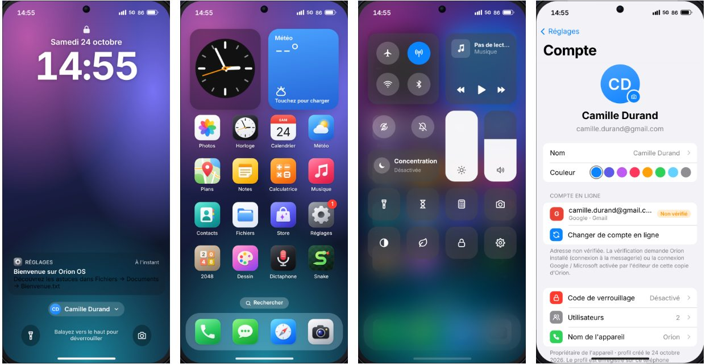
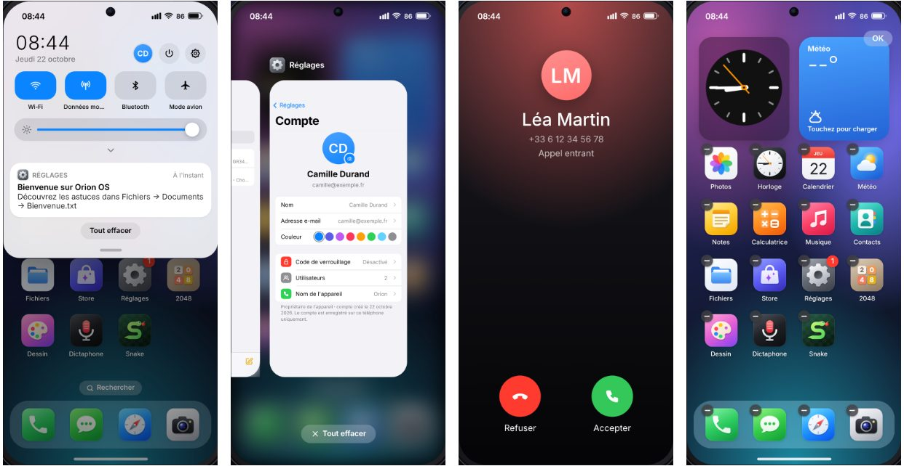
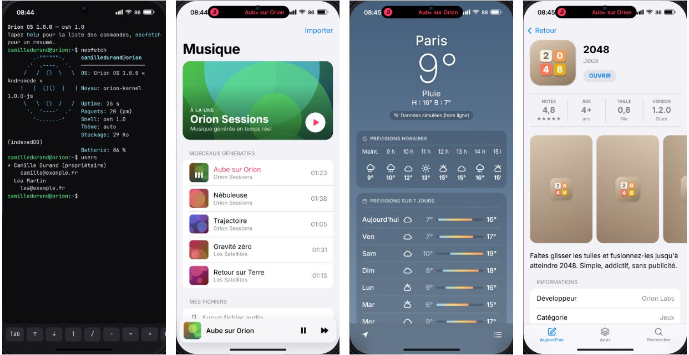

# Orion OS

**Orion OS** est un système d'exploitation mobile fonctionnel, inspiré à la fois d'**iOS** et d'**Android**, qui s'exécute dans n'importe quel navigateur moderne et s'installe en plein écran sur un vrai téléphone (application web progressive).

Comme Firefox OS ou KaiOS, il est construit sur les technologies du Web : un **noyau JavaScript** gère les processus, le système de fichiers, les paquets, les intents, les notifications, les alarmes, les permissions et une pile téléphonie ; une **interface système** fournit l'écran verrouillé, l'accueil, les gestes, le multitâche ; et **20 applications** sont livrées (dont 4 à installer depuis le Store).



## Démarrage rapide

Aucune dépendance n'est nécessaire pour l'exécuter (Node.js ≥ 20 sert uniquement de serveur local) :

```bash
npm start
# → http://localhost:8080
```

- **Sur ordinateur**, le système s'affiche dans un cadre de téléphone avec ses boutons physiques (latéral, volume, silencieux) ; la souris remplace le doigt et le clic droit l'appui long.
- **Sur un téléphone**, il doit être servi en HTTPS : voir [Démarrer sur mobile](#démarrer-sur-mobile).
- N'importe quel hébergement statique convient (GitHub Pages, Netlify…) : tous les chemins sont relatifs.

Au premier démarrage, un assistant vous accueille (nom, thème, style de navigation, code de verrouillage). Toutes les données sont persistées dans IndexedDB.

## Démarrer sur mobile

Les navigateurs mobiles n'autorisent l'installation en plein écran, le fonctionnement hors ligne, la caméra, le micro et la localisation que sur une page **HTTPS**. Le plus simple est donc de publier Orion OS sur GitHub Pages (gratuit pour un dépôt public) :

1. Sur GitHub, ouvrez le dépôt → **Settings** → **Pages**.
2. Dans **Build and deployment**, choisissez **Source : Deploy from a branch**, puis la branche qui contient Orion OS et le dossier **/ (root)** → **Save**.
3. Après une à deux minutes, le système est en ligne à l'adresse `https://<utilisateur>.github.io/<dépôt>/` (par exemple `https://91val91.github.io/os/`).

Ouvrez ensuite cette adresse sur le téléphone et installez-la :

- **Android (Chrome)** : menu **⋮** → **Installer l'application** (ou « Ajouter à l'écran d'accueil »). L'icône Orion apparaît parmi vos applications ; elle s'ouvre en plein écran, sans barre d'adresse, et le bouton ou geste Retour d'Android agit dans Orion.
- **iPhone / iPad (Safari)** : bouton **Partager** → **Sur l'écran d'accueil**, en laissant « Ouvrir en tant qu'app web » activé → **Ajouter**.

Lancez toujours Orion depuis cette icône : dans un onglet du navigateur, la barre d'adresse reste visible et les gestes du bord de l'écran appartiennent au navigateur. Après la première ouverture, tout est en cache et le système démarre même sans réseau. Les mises à jour publiées sont téléchargées en arrière-plan et appliquées au lancement suivant, ou tout de suite en redémarrant Orion (bouton marche-arrêt du volet de notifications → Redémarrer).

**Sans hébergement**, depuis votre ordinateur :

- `HOST=0.0.0.0 npm start` puis `http://<ip-de-l-ordinateur>:8080` sur un téléphone du même Wi‑Fi : pratique pour un essai, mais en HTTP il n'y a ni installation, ni hors ligne, ni caméra, ni localisation.
- Un tunnel HTTPS temporaire lève ces limites : `npm start` dans un terminal, puis `cloudflared tunnel --url http://localhost:8080` dans un autre, et ouvrez l'adresse `https://….trycloudflare.com` affichée (elle change à chaque lancement).
- Android branché en USB : dans Chrome sur l'ordinateur, `chrome://inspect` → **Port forwarding** `8080 → localhost:8080`, puis `http://localhost:8080` sur le téléphone, qui compte comme une adresse sécurisée.

**Limites sur un vrai téléphone** : Orion OS reste une application web. Quand le téléphone est en veille ou qu'une autre application est au premier plan, il est suspendu : réveils et minuteurs ne sonnent qu'une fois Orion rouvert. Les appels et SMS sont simulés, et les boutons physiques (volume, marche) restent ceux du téléphone hôte ; utilisez le centre de contrôle et le menu marche-arrêt d'Orion. Sur iPhone, l'app installée ne partage pas ses données avec Safari : ce qui a été configuré dans un onglet est à refaire dans l'app.

## Prise en main

| Geste / touche | Action |
| --- | --- |
| Glisser vers le haut depuis le bas | Retour à l'accueil (l'app rétrécit vers son icône) |
| Glisser vers le haut et maintenir | Applications récentes (cartes, glisser vers le haut pour fermer) |
| Glisser latéralement sur la barre du bas | Basculer vers l'app précédente |
| Glisser depuis le bord gauche ou droit, ou Retour du téléphone Android | Retour |
| Tirer la barre d'état à gauche | Volet de notifications et réglages rapides (Android) |
| Tirer la barre d'état à droite | Centre de contrôle (iOS) |
| Glisser vers le haut sur l'accueil | Tiroir d'applications avec recherche universelle |
| Appui long sur une icône | Raccourcis, infos, suppression, mode édition (glisser-déposer) |
| Bouton latéral (Alt+L) / appui long (Alt+P) | Veille et verrouillage / menu marche-arrêt |
| Échap · Alt+H · Alt+R · Alt+N · Alt+C | Retour · Accueil · Récentes · Notifications · Centre de contrôle |
| Alt+↑ / Alt+↓ | Volume |

Vous préférez la navigation Android à trois boutons (◁ ○ ▢) ? **Réglages → Personnalisation → Navigation système**. La forme des icônes (iOS, arrondie, ronde façon Android), la couleur d'accentuation, le thème, le fond d'écran et la taille du texte se règlent au même endroit.



## Fonctionnalités

**Système**
- **Comptes et utilisateurs** : l'assistant crée votre compte (nom, e-mail facultatif) ; d'autres personnes peuvent avoir le leur sur le même téléphone (**Réglages → Compte → Utilisateurs**). Chaque compte a ses apps, fichiers, photos, contacts, messages, réglages et code ; on change d'utilisateur depuis l'écran verrouillé ou le volet de notifications. Les comptes sont enregistrés sur l'appareil uniquement (pas de synchronisation en ligne).
- Écran verrouillé avec horloge, notifications, lecture en cours, lampe et appareil photo ; code PIN haché (SHA-256 salé), blocage après 5 essais, appel d'urgence.
- Accueil à pages avec dock, widgets (horloge, météo), badges, icônes vivantes (date du Calendrier, aiguilles de l'Horloge), mode édition par glisser-déposer.
- Multitâche : une instance par app, apps en arrière-plan conservées, écran des récentes, arrêt automatique des plus anciennes (« low memory killer »).
- Notifications en bannière, volet groupé, « Ne pas déranger », autorisation par app.
- Îlot d'activités en direct : appel en cours, minuteur, musique, enregistrement.
- Permissions à l'exécution (appareil photo, micro, localisation, contacts) : « Autoriser », « Une seule fois », « Refuser », révocables dans les Réglages.
- Intents à la Android : « Ouvrir avec », « Partager avec », sélection d'une photo ou d'un contact depuis une autre app (`startActivityForResult`).
- Alarmes système : réveils, minuteurs et rappels sonnent même si l'app est fermée.
- Thèmes clair/sombre/automatique, Night Shift, luminosité, économiseur de batterie, options pour les développeurs (appuyez 7 fois sur le numéro de build).

**Applications**

| App | Points clés |
| --- | --- |
| Téléphone | Clavier DTMF, récents, favoris, messagerie vocale |
| Messages | Conversations, photos jointes, indicateur de saisie, correspondants simulés qui répondent (aucun contact ni conversation fictifs au départ) |
| Contacts | Carnet d'adresses partagé, index alphabétique, sélection pour d'autres apps |
| Appareil photo | Caméra réelle (ou scène simulée), filtres, formats photo/carré, caméra avant/arrière |
| Photos | Photothèque par mois, albums, favoris, visionneuse avec balayage et zoom, fond d'écran |
| Horloge | Horloge mondiale, réveils avec jours de répétition, chronomètre à tours, minuteur |
| Calculatrice | Saisie d'expressions avec aperçu, mode scientifique, historique |
| Notes | Fichiers texte dans `/home/Documents/Notes`, recherche, épinglage, partage |
| Calendrier | Vue mensuelle, événements, rappels |
| Météo | Prévisions réelles via Open-Meteo, géolocalisation, recherche de villes ; données simulées hors ligne |
| Musique | Morceaux génératifs synthétisés en temps réel, import de fichiers audio, contrôle système |
| Navigateur | Barre d'adresse, favoris, historique, partage |
| Fichiers | Explorateur du système de fichiers, import/export, renommage, déplacement |
| Réglages | Réseau, notifications, sons, affichage, fonds d'écran, confidentialité, code, batterie, stockage, apps |
| Terminal | Shell `osh` avec tubes, redirections, complétion et plus de 60 commandes |
| Store | Catalogue, installation et désinstallation d'applications |
| 2048, Snake, Dessin, Dictaphone | À installer depuis le Store |



## Architecture

```
┌────────────────────────── Applications (src/apps) ──────────────────────────┐
│ Téléphone · Messages · Photos · Réglages · Terminal · Store · …              │
│                 mount(root, ctx)  ←  contexte d'application (SDK)           │
├────────────────────────── Interface système (src/system) ───────────────────┤
│ Gestionnaire de fenêtres · Écran verrouillé · Accueil · Tiroir · Volet      │
│ Centre de contrôle · Navigation (gestes/boutons) · Appels · Alarmes · …     │
├────────────────────────── Noyau (src/kernel) ───────────────────────────────┤
│ accounts · processes · intents/activités · packages · vfs · settings        │
│ notifications · alarms · permissions · media · contacts · telephony · shell │
├────────────────────────── Stockage ─────────────────────────────────────────┤
│ une base par compte : IndexedDB  →  localStorage  →  mémoire                │
└─────────────────────────────────────────────────────────────────────────────┘
```

- Le **noyau** est du JavaScript pur, sans accès au DOM : il est entièrement testé sous Node.js.
- Les services communiquent par un **bus d'événements** (`process:start`, `notification:post`, `alarm:fire`, `call:state`…).
- Les **comptes** sont listés dans un registre séparé (`orion-accounts`) ; chaque compte a sa propre base (`orion-os` pour le propriétaire, celle d'avant les comptes), ouverte au démarrage : changer d'utilisateur redémarre le système sur ses données.
- Le **système de fichiers virtuel** est hiérarchique (`/home`, `/data/<app>`, `/system` en lecture seule, `/tmp`), lisible de façon synchrone et persisté de façon asynchrone.
- L'**interface système** est l'« hôte » du gestionnaire d'activités : elle crée une fenêtre par processus, charge le module de l'app à la demande et l'anime.

## Écrire une application

1. Déclarez-la dans `src/apps/registry.js` :

```js
{
  id: 'meteo-plus',
  name: 'Météo+',
  icon: 'cloud-sun',              // nom d'icône de src/lib/icons.js
  color: ['#5bb8ff', '#1f5fd6'],  // dégradé de l'icône
  category: 'Météo',
  permissions: ['location'],
  intents: [{ action: 'view', types: ['text/plain'] }],
  load: () => import('./meteo-plus/index.js'),
}
```

2. Exportez une fonction `mount` :

```js
import { h } from '../../lib/dom.js';
import { page, button } from '../../lib/ui.js';

export function mount(root, ctx) {
  const view = page({ title: 'Météo+', content: button('Me notifier', { onClick: () => ctx.notify({ title: 'Bonjour !' }) }) });
  root.append(view);
  return { onPause() {}, onResume() {}, onIntent(intent) {}, onDestroy() {} };
}
```

Le contexte `ctx` donne accès au système :

| API | Rôle |
| --- | --- |
| `ctx.fs`, `ctx.storage` | Système de fichiers, préférences privées (`/data/<id>/storage.json`) |
| `ctx.notify(options)` | Publier une notification |
| `ctx.startActivity(intent)`, `ctx.startActivityForResult(intent)`, `ctx.finish(result)` | Intents |
| `ctx.requestPermission('camera')` | Permission à l'exécution |
| `ctx.alarms.schedule({ at \| hour, minute, days })` | Alarmes système |
| `ctx.media.set(meta, handlers)` | Session multimédia (centre de contrôle, écran verrouillé) |
| `ctx.ui.toast/alert/confirm/prompt/actionSheet/share/liveActivity` | Interface système |
| `ctx.on('pause' \| 'resume' \| 'intent' \| 'destroy')`, `ctx.onBack(fn)` | Cycle de vie et bouton Retour |
| `ctx.setTimeout/setInterval/raf/subscribe` | Ressources libérées automatiquement à la fermeture |

Les apps système reçoivent en plus `ctx.kernel` et `ctx.system`.

## Le shell `osh`

```sh
$ neofetch
$ ls -l /home/Photos | grep jpg | wc -l
$ echo "Courses : pain, café" > ~/Documents/liste.txt && open ~/Documents/liste.txt
$ pm list -a ; pm install snake ; open snake
$ ps ; kill 104
$ users                             # comptes de l'appareil
$ sim sms 0612345678 "Coucou !"     # simule un SMS entrant
$ settings set theme dark
$ calc "sqrt(2) * 10"
```

Opérateurs `|`, `>`, `>>`, `;`, `&&`, `||`, variables (`$HOME`, `$?`), jokers (`*.txt`), historique (↑/↓) et complétion (Tab). `help` liste toutes les commandes.

## Tests

```bash
npm test            # 50 tests unitaires du noyau (node:test, sans dépendance)
npm install && npx playwright install chromium
npm run test:e2e    # parcours complet dans Chromium : configuration, 20 apps, gestes, code PIN, comptes
npm run lint        # ESLint
npm run screenshots # régénère les captures du README
```

## Structure du projet

```
index.html, manifest.webmanifest, sw.js   PWA (plein écran, hors ligne)
src/main.js                               point d'entrée
src/kernel/                               noyau (services, shell, stockage)
src/system/                               interface système
src/apps/                                 applications et registre
src/lib/                                  DOM, icônes, gestes, kit d'interface, calcul, formats
src/styles/                               jetons de design, interface système, composants
tests/                                    tests unitaires et de bout en bout
scripts/                                  serveur local, icônes PWA, captures du README
```

## Ce qui est réel, ce qui est simulé

Orion OS est un système d'exploitation **applicatif** : il gère ses propres processus, fichiers, paquets et périphériques virtuels, mais il s'appuie sur le navigateur (et donc sur Android ou iOS) pour le matériel. Concrètement :

- **réels** quand le navigateur les fournit : appareil photo, micro, géolocalisation, niveau de batterie, vibreur, son, réseau (état en ligne, API météo), synthèse vocale, plein écran et hors ligne ;
- **simulés** : le modem (appels et SMS avec correspondants automatiques), les réseaux Wi‑Fi/Bluetooth listés, la lampe torche, la batterie sur un ordinateur sans batterie.

Pour en faire le système principal d'un appareil, il faudrait le placer au-dessus d'un noyau Linux et d'une couche matérielle native, à la manière de Firefox OS (B2G) ou KaiOS : un navigateur en mode kiosque lancé au démarrage, avec des API natives pour la téléphonie.

## Licence

Apache 2.0 — voir [LICENSE](LICENSE).
